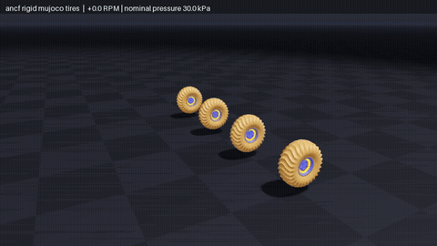
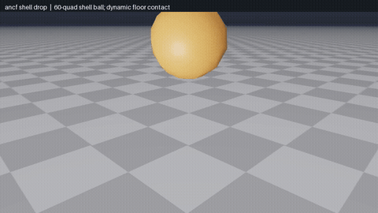
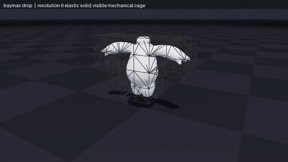
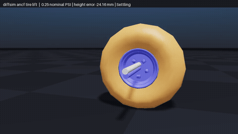
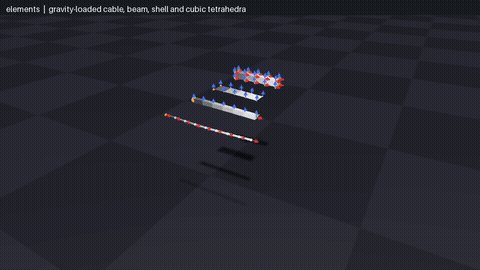
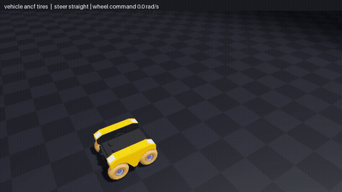

<!-- Generated by tools/build_readme.py; edit pyproject.toml and the sources in docs/. -->
# newton-solver-ancf

Differentiable ANCF cable, beam, shell and tetrahedral mechanics for Newton.

## Run

From this directory:

```bash
./docker/build.sh
./docker/run.sh                 # Choose an automatically discovered example.
./docker/run.sh --list          # List examples without Docker or GPU access.
./docker/run.sh <example>       # Run one example.
```

For local development:

```bash
uv sync --locked --extra examples
uv run --locked python -m newton_solver_ancf.examples
```

Linux x86-64 or ARM64, Python 3.12. CUDA runs need an NVIDIA driver compatible with the locked CUDA 13 Warp wheel; Docker GPU runs also need NVIDIA Container Toolkit. Use `--cpu --headless` before the example name for supported CPU scenes. Visual Docker runs use the local X11 display and a readable `XAUTHORITY` file. Use `./docker/run.sh -- COMMAND ...` for an arbitrary container command. Source is mounted from this directory; rebuild after changing dependencies.

## Dependencies

Installed runtime packages: `newton==1.7.0`, `warp-lang==1.17.0`, `numpy>=2,<3`, `scipy>=1.14,<2`. No sibling solver package or external source checkout is required. The `examples` extra supplies the viewer and any USD/robot dependencies; `uv.lock` fixes their versions. Example-specific data requirements are listed below.

## Example controls and dependencies

Install the `examples` extra to run the bundled scenes. It includes USD loading,
the Newton viewer, and MuJoCo simulation dependencies. No sibling solver package,
geometry package, asset generator, or external checkout is required. Python 3.12,
Newton 1.7.0, and Warp 1.17.0 are pinned; NumPy and SciPy provide host geometry
and sparse static-equilibrium solves. USD on Linux ARM64 additionally needs the
Python shared library (`libpython3.12.so.1.0`), installed by the Docker image.

`elements` and `baymax_drop` support CPU or CUDA. The tire rigs, vehicle, and
live tire optimization use CUDA. Example and asset menus discover packaged
files automatically. `--help` on a selected example lists its controls.

| Example | What it demonstrates |
| --- | --- |
| `elements` | Four clamped cable, beam, shell and cubic-tetrahedron specimens under gravity; per-specimen flexibility sliders, grayscale surfaces and optional director arrows |
| `baymax_drop` | A filled elastic Baymax solid drops onto a floor; its tetrahedral cage is visible around the detailed surface |
| `ancf_shell_drop` | The small 60-quad shell ball falls onto a frictional plane by default; choose other geometry with `--tire-asset` |
| `ancf_rigid_mujoco_tires` | Four detailed Warthog tires (2,128 nodes / 2,016 quads each) on independent spindles, with manual pressure and motion controls |
| `vehicle_ancf_tires` | A rigid vehicle on deformable tires; vehicle, compatible spindle tires and pressure controls come from USD metadata |
| `diffsim_ancf_tire_lift` | Fit tire pressure to a target static rim height, then check the fitted pressure in a live wheel rig; optional telemetry fitting |

The default Baymax mechanics resolution is 6 (84 nodes and 204 tetrahedra); its
9,882-triangle display mesh does not add mechanical DOFs. It is an elastic solid
with no gas inflation. Contact samples cage nodes, so the detailed display
surface can cross the floor between those samples.
The cage is shown by default; hide it with `--no-show-cage` or the viewer checkbox.

The wheel-rig asset menu defaults to the detailed Warthog tire and matching spindle.
Use `--tire-asset warthog_ancf_tire_simple.usda` for the smaller mesh. Pressure stays
under manual control in normal runs. The README recorder cycles tire pressure
while rolling the rigs forward and backward. Its vehicle preview drives, turns
left and right using Warthog's differential wheel braking, then stops. These
sequences use the existing manual controls without changing timesteps or
iteration budgets. Ordinary launches retain manual controls and the vehicle and
tire-fitting examples retain their own defaults.

All scenes advance 1/60 simulation second per frame. Default substeps are 4 for
`elements`, 1 for `baymax_drop`, 6 for the drop/rig/Warthog vehicle, 8 for the
Superjeep vehicle, and 10 for tire-lift preview. Increasing movie playback speed
or replaying saved states does not measure live simulation throughput.

The detailed Sherp wheel rig is experimental: its default 6-substep, 2-Newton,
10-PCG configuration has a recorded non-finite failure at frame 9. The simple
tire is available in the asset menu. Per-tire density overrides in batched tires do not create
independent masses: the implementation assembles the first tire's mass and
tiles it across environments.

The vehicle uses an adaptive fallback when a whole-frame conditional CUDA graph
cannot capture allocations in the installed MuJoCo Warp backend. This preserves
execution but can affect speed. See [validation](docs/validation.md) for the tested
scope; real-time rates depend on scene, resolution, device and viewer cost.

## Method

ANCF (absolute nodal coordinate formulation) represents the position field by
$\mathbf r(\mathbf X)=\mathbf S(\mathbf X)\mathbf q$, with global positions and
spatial derivatives as coordinates. The package supplies four element families:

| Element | Coordinates | Elastic model |
| --- | --- | --- |
| Cable | 2 nodes, 12 DOFs | Cubic Hermite centerline; axial Green strain and curvature bending; no torsion |
| Beam | 3243: 2 nodes, 24 DOFs; 3333: 3 nodes, 27 DOFs | Shear-deformable continuum beam; selective integration |
| Shell | 3423: 4 nodes, 24 DOFs | Bilinear position/director interpolation; assumed natural strains (ANS) |
| Tetrahedron | 4 nodes, 48 DOFs | Cubic FN interpolation; straight reference cells; 46-point degree-eight quadrature |

For continuum elements, $\mathbf F=\partial\mathbf r/\partial\mathbf X$,
$\mathbf E=(\mathbf F^T\mathbf F-\mathbf I)/2$, and

$$
U(\mathbf q)=\frac12\int_{\Omega_0}\mathbf e^T\mathbf C\mathbf e\,dV,
\qquad \mathbf M=\int_{\Omega_0}\rho\mathbf S^T\mathbf S\,dV,
\qquad \mathbf f_{\rm int}=\nabla U,\quad \mathbf K=\nabla^2U.
$$

Here $\mathbf e$ contains Green strain with engineering shear components and
$\mathbf C$ is the constitutive matrix. Generalized elements use float64,
consistent mass, and exact local energy Hessians assembled into sparse CSR.
The cable uses axial and isotropic curvature energy; its intrinsic curvature
norm is regularized for initially curved elements. It has no material frame.

## Shared HHT integration

Both generalized elements and optimized tires use the same HHT formulas, with
$\alpha=-0.2$, $\beta=(1-\alpha)^2/4=0.36$, $\gamma=1/2-\alpha=0.7$:

$$
\begin{aligned}
\widehat{\mathbf q}&=\mathbf q_n+h\mathbf v_n+h^2(1/2-\beta)\mathbf a_n,&
\widehat{\mathbf v}&=\mathbf v_n+h(1-\gamma)\mathbf a_n,\\
\mathbf a&=(\mathbf q-\widehat{\mathbf q})/(\beta h^2),&
\mathbf v&=\widehat{\mathbf v}+\gamma h\mathbf a,\\
\mathbf R&=\mathbf M\mathbf a+(1+\alpha)(\mathbf I-\mathbf f_{\rm ext})
-\alpha(\mathbf I_n-\mathbf f_{{\rm ext},n})=\mathbf0,&
\mathbf I&=\nabla U+\mathbf C_d\mathbf v.
\end{aligned}
$$

Generalized elements use $\mathbf C_d=c\mathbf M$ and a regularized Newton
direction with Armijo search; acceptance checks the unregularized residual.
Sparse PCG checks curvature and the true residual. Position, velocity,
acceleration, and both force histories travel together between steps.
Initial states have zero acceleration/history; `initialize_history()` fills
forces but does not solve for a dynamically consistent initial acceleration.

The optimized tire path uses float32, lumped mass, sparse six-DOF node blocks,
fixed Newton/PCG budgets, pressure and friction. Single-tire kernels update
enhanced assumed strains (EAS); batched kernels keep EAS variables zero.
Shared HHT does not make its approximate tangent, convergence policy or state
layout identical to the generalized path. Rigid coupling is separate in
`_src/solvers/coupled/`; the MuJoCo adapter uses the installed public API.

## Derivatives and contact

A generalized recorded step differentiates its converged residual on free DOFs:

$$
\mathbf R_{\mathbf q}^{T}\boldsymbol\lambda=L_{\mathbf q},
\qquad \frac{dL}{d\theta}=L_\theta-\mathbf R_\theta^T\boldsymbol\lambda.
$$

The adjoint uses the unshifted sparse tangent with a checked GMRES fallback.
Supported inputs include all state histories, loads, prescribed coordinates,
and exposed stiffness parameters. Geometry, topology, mass/density, timestep,
gravity and contact coefficients stay fixed. Input arrays must remain unchanged
until backward; derivatives assume a locally nonsingular converged branch.
The generalized frictionless floor uses $d=z_{\rm floor}-z$,
$p=(d+\sqrt{d^2+s^2})/2$, and $V_{\rm floor}=kp^2/2$ at position nodes.

`ANCFTireEquilibrium` differentiates static shell/rim equilibrium for pressure
and stiffness fitting. Its tangent includes EAS condensation, nonsymmetric
follower pressure, and a sealed-cavity rank-one term. Sparse LU on
$\left[\begin{smallmatrix}K&u\\-v^T&1\end{smallmatrix}\right]$
applies $K+uv^T$ without forming a dense outer product. These derivatives hold
on a fixed contact/EAS-clipping branch. The dynamic tire and MuJoCo trajectories
do not have this adjoint; `diffsim_ancf_tire_lift` validates the static fit in a
live rig without differentiating that trajectory.

## Papers

The following describe the formulation foundations; the numerical choices and
derivative scope above describe this implementation.

- Hilber, Hughes and Taylor (1977), [Improved numerical dissipation for time integration algorithms in structural dynamics](https://doi.org/10.1002/eqe.4290050306): HHT integration.
- Gerstmayr and Shabana (2006), [Analysis of Thin Beams and Cables Using the Absolute Nodal Co-ordinate Formulation](https://doi.org/10.1007/s11071-006-1856-1): cable kinematics and strain energy.
- Nachbagauer, Gruber and Gerstmayr (2013), [Structural and Continuum Mechanics Approaches for a 3D Shear Deformable ANCF Beam Finite Element](https://doi.org/10.1115/1.4006787): shear-deformable beam formulation.
- Yamashita, Valkeapää, Jayakumar and Sugiyama (2015), [Continuum Mechanics Based Bilinear Shear Deformable Shell Element Using Absolute Nodal Coordinate Formulation](https://doi.org/10.1115/1.4028657): ANCF shell formulation.
- Pappalardo, Wang and Shabana (2017), [Development of ANCF tetrahedral finite elements for the nonlinear dynamics of flexible structures](https://doi.org/10.1007/s11071-017-3635-6): cubic FN tetrahedron.

## Paper-to-code guide

The links below map the papers to the implemented equations and methods.
Partial implementations and differences are identified alongside the code.

## Cubic ANCF tetrahedra

[Pappalardo, Wang and Shabana (2017)](https://doi.org/10.1007/s11071-017-3635-6),
*Development of ANCF tetrahedral finite elements for the nonlinear dynamics of
flexible structures*, describes both FN and ENMC elements. This package implements
the four-node FN branch with 48 coordinates, restricted to straight reference cells.

| Paper location | Implementation |
| --- | --- |
| §5, Eq. (33), Appendix A Eq. (A.4): cubic FN interpolation and Cartesian gradients | [`tetrahedron.py`](src/newton_solver_ancf/_src/solvers/ancf/tetrahedron.py): `_shape_functions_batch`, `SolverANCFTetrahedron.shape_functions`, and device `tetrahedral_shape_values` |
| §7.1, Eq. (37): spatial derivatives | [`tetrahedron.py`](src/newton_solver_ancf/_src/solvers/ancf/tetrahedron.py): `_reference_coordinates` and the derivative branch of `shape_functions` |
| §7.2, Eq. (38): constant mass | [`tetrahedron.py`](src/newton_solver_ancf/_src/solvers/ancf/tetrahedron.py): `SolverANCFTetrahedron.create_model` integrates local mass and creates the sparse model |
| §7.4: elastic generalized forces | [`tetrahedron.py`](src/newton_solver_ancf/_src/solvers/ancf/tetrahedron.py): `_kinematics`, `_energy`, `_gradient`, `_hessian` |

The paper derives equations rather than numbered executable pseudocode. The
following summarizes this implementation's sequence:

```text
create_model: validate tetrahedra; compute FN shape values and derivatives;
              integrate consistent mass and cache reference quadrature
per trial q: compute F and Green strain at quadrature points;
             reject nonpositive det(F); integrate energy, force and tangent
assemble local contributions into CSR; solve the HHT step on free coordinates
```

The final solve is `SolverImplicit.step` in
[`implicit/solver.py`](src/newton_solver_ancf/_src/solvers/implicit/solver.py);
[`implicit/sparse.py`](src/newton_solver_ancf/_src/solvers/implicit/sparse.py)
provides CSR assembly and linear solves.

The positive 46-point rule, guarded sparse solve, HHT integrator and custom
implicit adjoint are implementation choices. The ENMC branch and the paper's
full benchmark suite are not supplied by this package.

## Cable and shell ANCF

[Recuero and Negrut (2016), *The Absolute Nodal Coordinate Formulation — ANCF*](https://www.projectchrono.org/assets/white_papers/FEA/WP_ANCF.pdf)
provides the following equation-level map. Its beam in §2 is the two-node cable,
not this package's shear-deformable 3243/3333 beam family.

| Paper location | Implementation |
| --- | --- |
| §2, Eqs. (2)–(6): centerline, axial/bending energy and mass | [`cable.py`](src/newton_solver_ancf/_src/solvers/ancf/cable.py): `cable_shape_functions`, `evaluate_element_energy`, `evaluate_elements`, `SolverANCFCable.create_model` |
| §3, Eqs. (7)–(12): bilinear shell interpolation and internal force | [`kernels_element.py`](src/newton_solver_ancf/_src/solvers/ancf/kernels_element.py): `_shape`, `_jacobian`, `_natural_strain`; [`kernels_stiffness.py`](src/newton_solver_ancf/_src/solvers/ancf/kernels_stiffness.py): `compute_element_forces_stiffness` |
| §3.1, Eqs. (13)–(19): reference/fiber transformation | [`kernels_element.py`](src/newton_solver_ancf/_src/solvers/ancf/kernels_element.py): `_compute_beta`, `_beta_transform_diag`, `_beta_transform_shear` |
| §3.2.2 and §3.2.4, Eqs. (31)–(32): EAS update and condensation | [`kernels_stiffness.py`](src/newton_solver_ancf/_src/solvers/ancf/kernels_stiffness.py): `compute_rest_jacobians`, `compute_element_forces_stiffness`; static condensation in [`differentiation.py`](src/newton_solver_ancf/_src/solvers/ancf/differentiation.py): `ANCFTireEquilibrium._elastic` |
| §3.2.3, Eqs. (26)–(28): ANS tying | [`kernels_element.py`](src/newton_solver_ancf/_src/solvers/ancf/kernels_element.py): `_e13_at`, `_e23_at`, `_e33_at`, and matching strain-derivative helpers |

There is no numbered algorithm in this white paper. The implemented tire loop is:

```text
precompute reference Jacobians, fiber transforms, EAS basis and lumped mass
predict coordinates with HHT
for each fixed-budget Newton correction:
    evaluate ANS/EAS shell force and approximate tangent
    add pressure/contact; impose bead coordinates; solve sparse block system
    correct coordinates, velocities and EAS variables
retain acceleration and old-force histories for the next step
```

This loop is in [`tire.py`](src/newton_solver_ancf/_src/solvers/ancf/tire.py):
`_precompute_mass`, `_precompute_rest_jacobians`, `_step_single` and `_step_batched`;
`_evaluate_forces_single` and `_evaluate_forces_batched` launch its element kernels.

The dynamic tire uses lumped mass and bounded EAS updates in single-tire kernels;
batched kernels keep EAS variables zero. Eq. (29) states a consistent mass integral. The generalized [`shell.py`](src/newton_solver_ancf/_src/solvers/ancf/shell.py)
uses conservative ANS without EAS. Cable curvature regularization, exact local
cable Hessians, pressure/contact laws, sparse PCG and implicit gradients are
additional implementation details, not claims made by that white paper.

## HHT and sparse topology updates

[Hilber, Hughes and Taylor (1977)](https://doi.org/10.1002/eqe.4290050306) maps to
[`implicit/hht.py`](src/newton_solver_ancf/_src/solvers/implicit/hht.py):
`predict_position`, `predict_velocity`, `weighted_residual`, `mass_scale` and
`stiffness_scale`. The [method](docs/method.md) states the implemented equations and
adjoint assumptions.

[Acharya and Hyde (2026), STA-FEM](https://arxiv.org/abs/2605.11673), §3.7
Algorithm 1, maintains a matrix under preplanned element additions/removals.
ANCF does not implement that topology-edit loop: its sparse pattern is fixed,
and nonlinear element contributions are recomputed as coordinates change.
[`implicit/sparse.py`](src/newton_solver_ancf/_src/solvers/implicit/sparse.py)
provides sparse storage and solves, not streaming deletion/addition bookkeeping.

## Examples

One demonstration clip per example. Click a preview to open its MP4. Videos show simulated motion rendered offline; playback rate is not a performance measurement.

| Example | Example |
| --- | --- |
| **[ancf_rigid_mujoco_tires](src/newton_solver_ancf/examples/example_ancf_rigid_mujoco_tires.py)**<br>Four detailed Warthog tires on independent MuJoCo spindles, with pressure and rolling controls.<br><a href="docs/media/ancf_rigid_mujoco_tires.mp4"></a><br>Four detailed Warthog tires (2,128 nodes / 2,016 quads each) roll forward and reverse at up to ±8 RPM while nominal pressure cycles 30 → 45 → 15 → 30 kPa. The recording scripts only the existing manual controls; native 6/2/10 substep/Newton/PCG budgets are retained.<br>`./docker/run.sh ancf_rigid_mujoco_tires` | **[ancf_shell_drop](src/newton_solver_ancf/examples/example_ancf_shell_drop.py)**<br>Drop the small 60-quad shell ball onto a frictional floor; choose other shells from the asset menu.<br><a href="docs/media/ancf_shell_drop.mp4"></a><br>The default small shell ball (62 nodes, 60 quads) drops onto a frictional plane using its authored material and unchanged 6 substeps, 3 Newton updates and 200 PCG iterations.<br>`./docker/run.sh ancf_shell_drop` |
| **[baymax_drop](src/newton_solver_ancf/examples/example_baymax_drop.py)**<br>Baymax drops onto a frictionless floor with its tetrahedral cage and detailed surface visible.<br><a href="docs/media/baymax_drop.mp4"></a><br>A filled elastic Baymax drops onto the floor, with its 84-node/204-tetrahedron mechanical cage visible around the detailed surface. No inflation.<br>`./docker/run.sh baymax_drop` | **[diffsim_ancf_tire_lift](src/newton_solver_ancf/examples/example_diffsim_ancf_tire_lift.py)**<br>Optimize tire pressure for a target axle height using static equilibrium gradients and a live MuJoCo preview.<br><a href="docs/media/diffsim_ancf_tire_lift.mp4"></a><br>Implicit static-equilibrium gradients fit nominal tire pressure to a synthetic target axle height; the live MuJoCo rig checks the resulting height. Dynamic trajectories are not differentiated.<br>`./docker/run.sh diffsim_ancf_tire_lift` |
| **[elements](src/newton_solver_ancf/examples/example_elements.py)**<br>Four clamped ANCF cantilevers bend under gravity: cable, beam, shell and cubic tetrahedra.<br><a href="docs/media/elements.mp4"></a><br>Four clamped cantilevers bend under gravity with nodal director arrows. Default geometry, stiffness and four HHT substeps are retained.<br>`./docker/run.sh elements` | **[vehicle_ancf_tires](src/newton_solver_ancf/examples/example_vehicle_ancf_tires.py)**<br>Choose a MuJoCo vehicle with matching pressure-controlled ANCF tires and spindles on flat ground.<br><a href="docs/media/vehicle_ancf_tires.mp4"></a><br>A Warthog drives on four deformable tires at up to 6 rad/s wheel command, turns left and right using differential wheel braking, then stops. This scripted preview uses the normal manual drive controls and default 6/2/10 substep/Newton/PCG budgets.<br>`./docker/run.sh vehicle_ancf_tires` |

## Regenerate documentation

```bash
python3 tools/build_readme.py
python3 tools/build_readme.py --check
uv run --locked python tools/record_examples.py --all
python3 tools/build_readme.py --require-videos
```

README generation uses only Python's standard library and discovers examples from their launcher. Recording needs the `examples` extra, `ffmpeg`, and OpenGL. `docs/videos.json` stores optional capture arguments; it does not define the example list. `tools/video_scenarios.py`, when present, scripts interactions for recording. Each clip has a metadata file recording arguments, frame count and capture conditions.

## Validate

```bash
uv run --locked ruff check .
uv run --locked ruff format --check .
uv run --locked python -m unittest discover -s tests -v
NEWTON_TEST_DEVICE=cuda:0 uv run --locked python -m unittest discover -s tests -v
uv build
```

See [validation scope and results](docs/validation.md).

License: [Apache-2.0](LICENSE). Required third-party attribution is in [THIRD_PARTY_NOTICES.txt](THIRD_PARTY_NOTICES.txt).
